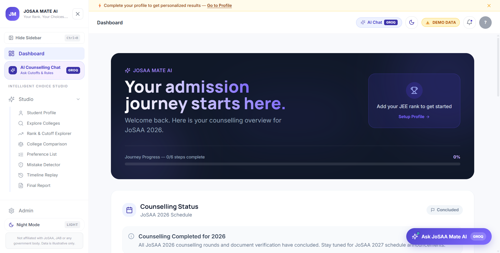
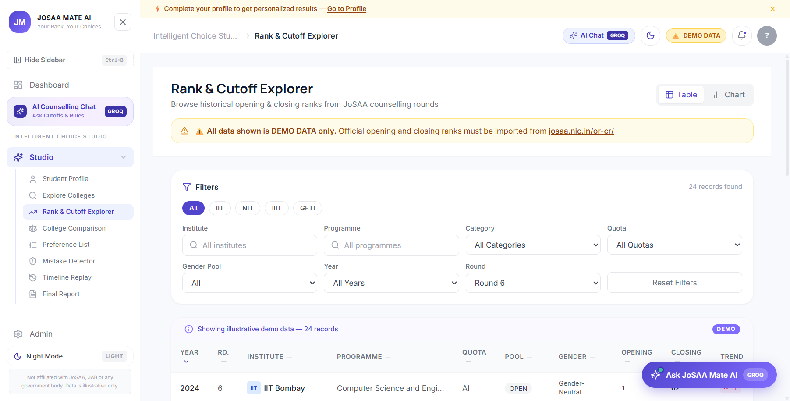
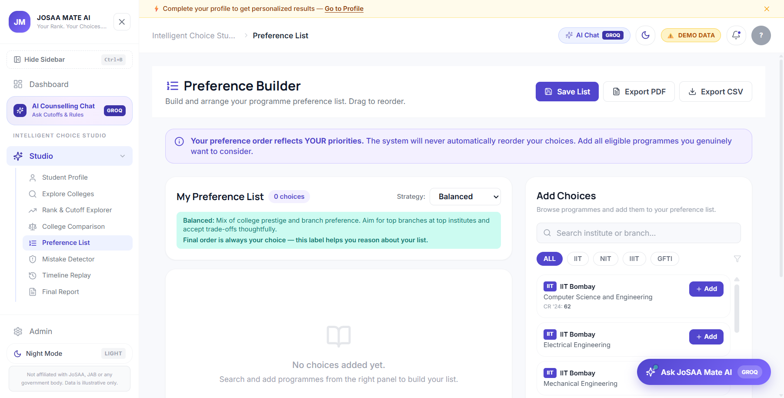
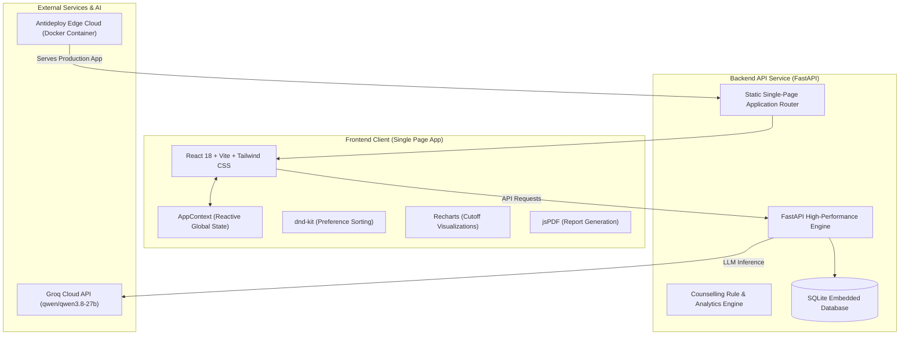

<div align="center">

# 🎓 JOSAA MATE AI
### *Your Rank. Your Choices. Your Future.*

**The Intelligent AI-Powered Decision Support Studio for Engineering Admissions in India**

[](https://josaamate-ai.antideploy.app)
[](https://antideploy.com)
[](https://groq.com)
[](https://github.com/amulbutter-web/josaamate_AI)

<br/>

[🌐 **Launch Live Platform**](https://josaamate-ai.antideploy.app) &nbsp;•&nbsp; [📊 **Key Features**](#-key-features) &nbsp;•&nbsp; [🏗️ **System Architecture**](#-system-architecture) &nbsp;•&nbsp; [🛠️ **Tech Stack**](#-tech-stack)

<br/>

---

### 🌐 Live Deployment
> **Production App:** [https://josaamate-ai.antideploy.app](https://josaamate-ai.antideploy.app)  
> *Fully interactive, high-performance web app with real-time AI Counselling Assistant enabled.*

---

</div>

<br/>

## 💡 The Problem & Mission

Every year, over **1.5 million students** appear for JEE Main and JEE Advanced in India. Navigating the subsequent **Joint Seat Allocation Authority (JoSAA)** process is notoriously complex, opaque, and stressful:

- **100+ Premier Institutes**: 23 IITs, 32 NITs, 26 IIITs, and 38+ GFTIs.
- **Multi-Dimensional Rules**: Home State (HS) vs. Other State (OS) quotas, All India (AI) seat pools, Gender-Neutral vs. Female-Supernumerary quotas.
- **High Stakes**: A single misordered choice or incorrect assumption regarding round float/freeze rules can lock a student out of their dream college or result in seat forfeiture.

**JoSAA Mate AI** bridges this critical gap. Built as an end-to-end **Intelligent Choice Studio**, it empowers students and parents with instant cutoff intelligence, algorithmic error detection, and an intelligent AI counsellor to build fail-safe preference lists.

---

## 📸 Platform Showcase

### 1. Unified Intelligence Dashboard
An overview tracking candidate scores, verified quotas, upcoming milestone countdowns, and allocation readiness.

<div align="center">
  
</div>

<br/>

### 2. Rank & Cutoff Explorer
Explore historical opening and closing ranks (2021–2024) across categories, branches, and rounds with comparative visual trend graphs.

<div align="center">
  
</div>

<br/>

### 3. Drag-and-Drop Preference Builder
Reorder and optimize college-branch combinations dynamically with proactive rule checks, probability tagging, and export to official JoSAA CSV format.

<div align="center">
  
</div>

---

## ✨ Key Features

| Capability | What It Delivers |
| :--- | :--- |
| 🤖 **AI Counselling Co-Pilot** | Real-time AI advisory powered by Groq Qwen models. Answers admission questions, clarifies Float/Slide/Freeze nuances, and adapts advice to student rank and home state. |
| 🛡️ **Mistake Detector Engine** | Scans preference lists for common pitfalls: entering duplicate choices, putting higher-cutoff branches below lower-cutoff branches, or miscalculating quota eligibility. |
| 📊 **Historical Trend Analytics** | Interactive 4-year cutoff trends (2021–2024) helping predict realistic allotment ranges for safe, moderate, and ambitious choices. |
| ⚖️ **Side-by-Side College Compare** | Compare up to 4 institute-programme options simultaneously across NIRF rankings, average packages, location, and historical closing ranks. |
| 🔄 **Round Timeline Simulation** | Illustrative step-by-step replay of seat progression through Rounds 1 to 6 to demystify how choices float and lock. |
| 📄 **One-Click Export** | Generates print-ready PDF strategy reports and downloadable CSVs formatted for direct entry into the JoSAA counselling portal. |

---

## 🏗️ System Architecture

JoSAA Mate AI uses a decoupled client-server architecture containerized with a multi-stage Docker pipeline and hosted on high-availability edge infrastructure:



### Repository Structure

```text
josaamate_AI/
├── frontend/                     # Modern React Single Page Application
│   ├── src/
│   │   ├── components/           # UI components (Header, Sidebar, Badges)
│   │   ├── components/chat/      # AiChatBox intelligent assistant
│   │   ├── pages/                # Studio views (Cutoffs, Compare, Preferences, Timeline)
│   │   ├── store/                # Reactive state management (AppContext)
│   │   └── types/                # Strict TypeScript domain interfaces
│   ├── package.json              # Client dependencies
│   └── vite.config.ts            # Vite build configuration
├── backend/                      # Production FastAPI Application
│   ├── main.py                   # REST endpoints, AI streaming & SPA router
│   ├── demo_seed.py              # Normalized counselling seed data
│   ├── josaa_mate.db             # Local relational data store
│   └── requirements.txt          # Python dependencies
├── screenshots/                  # High-resolution application captures
├── Dockerfile                    # Multi-stage production container manifest
├── .antideploy.json              # Antideploy deployment specification
└── README.md                     # Project documentation & presentation
```

---

## 🛠️ Tech Stack

<div align="center">

| Layer | Technologies |
| :--- | :--- |
| **Frontend Framework** | `React 18` • `TypeScript` • `Vite 6` |
| **Styling & Animation** | `Tailwind CSS 3` • `Framer Motion` • `Lucide React` |
| **Data & Drag/Drop** | `Recharts` • `dnd-kit` • `Papaparse` • `jsPDF` |
| **Backend Framework** | `Python 3.11` • `FastAPI` • `Pydantic v2` • `Uvicorn` |
| **Database & Analytics** | `SQLite` (Development) / `PostgreSQL` compatible • `Pandas` |
| **Artificial Intelligence** | `Groq Cloud API` • `Qwen 3.8 27B LLM` |
| **DevOps & Cloud** | `Docker (Multi-stage)` • `Antideploy Edge Infrastructure` |

</div>

---

## ⚠️ Important Disclaimers

> [!NOTE]
> - **Independent Advisory**: JoSAA Mate AI is an independent academic project and is **not affiliated** with the official Joint Seat Allocation Authority (JoSAA), CSAB, NTA, or any government body.
> - **Simulated Guidance**: The platform offers decision-support analytics and does not submit preferences directly to the official JoSAA portal. Students should always cross-reference their final choices with official guidelines published at [josaa.nic.in](https://josaa.nic.in).

---

<div align="center">
  <b>Built with ❤️ for Indian engineering aspirants</b><br/>
  <sub>© 2026 JoSAA Mate AI. All rights reserved.</sub>
</div>
